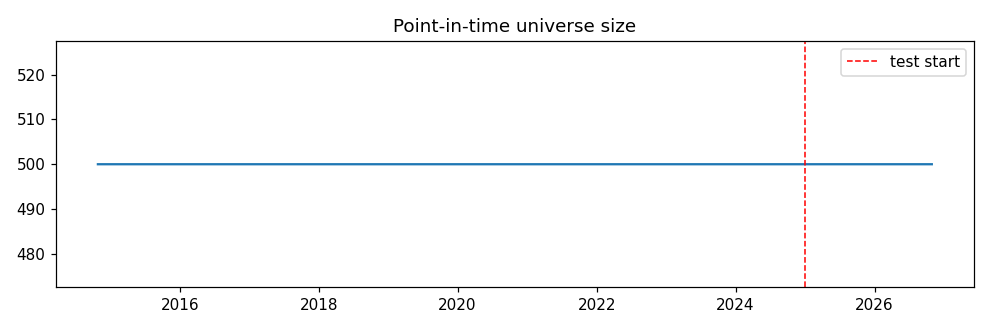
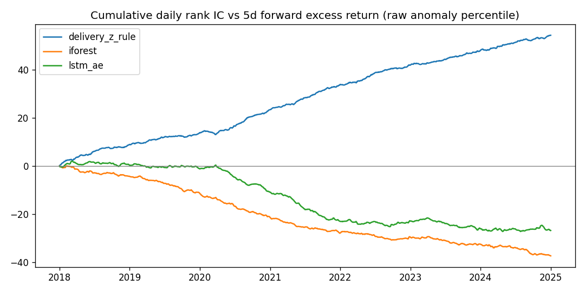
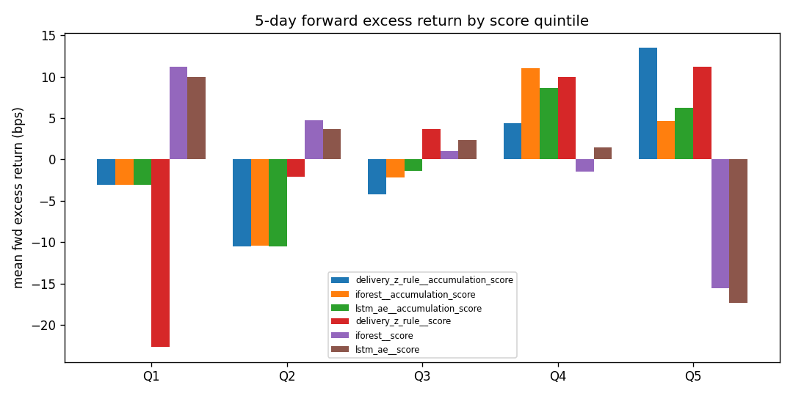
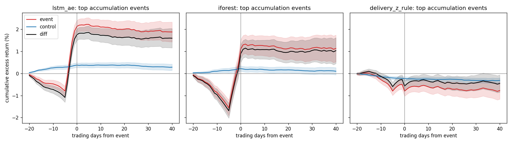
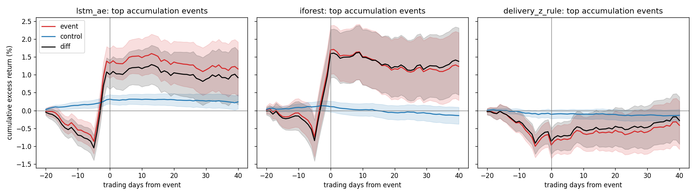
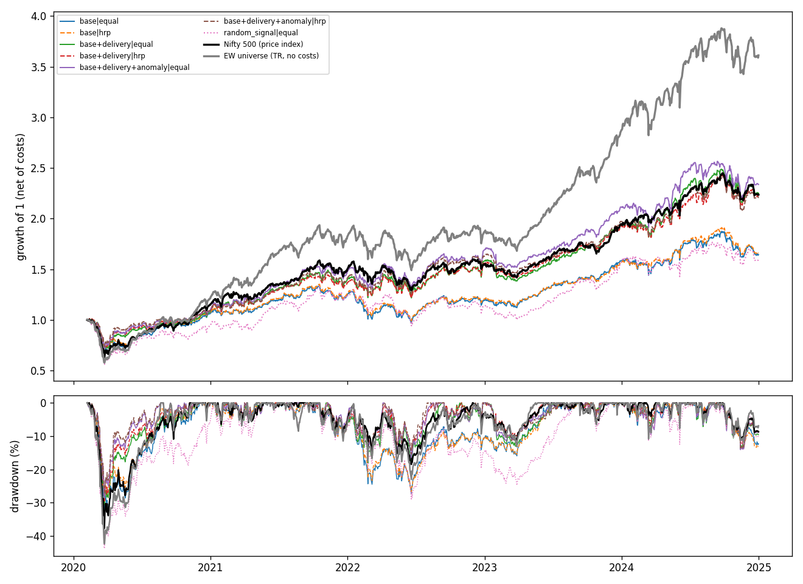
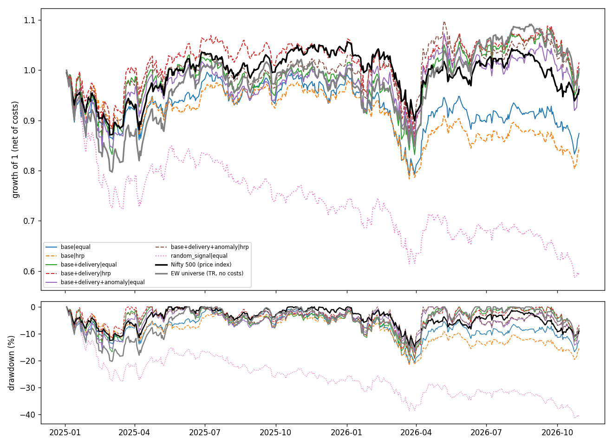

# NSE Smart-Money Anomaly Detector — Report

Run `20261030-001505-ea0626` · git `f2c442ff1612` · config `ea06264ccbfd` · data snapshot `49dd066c92b62832`

**Research question.** Do anomalies in India-specific market activity — unusual delivery
volumes, bulk/block-deal clustering and abnormal price-volume behaviour — predict a stock's
excess return over the next 1–4 weeks, after realistic trading costs?

Development period: 2015-01-01 → 2024-12-31 (all tuning). Held-out test period:
2025-01-01 → end of data, evaluated **1** time(s) with this configuration.

## 1. Data coverage

| item | value |
|---|---|
| daily panel rows (EQ series) | 4,915,953 |
| securities | 3,161 |
| trading days | 3,162 |
| date range | 2014-01-01 → 2026-10-29 |
| rows with delivery data | 100.0% |
| bulk deals | 132,890 |
| block deals | 11,171 |
| corporate actions: dividend | 16,541 |
| corporate actions: bonus | 475 |
| corporate actions: split | 457 |
| corporate actions: rights | 303 |
| corporate actions: merger | 159 |
| corporate actions: consolidation | 2 |
| securities ever in the universe | 1,321 |

### Data-quality flags

| flag | rows | pct | excluded |
|---|---|---|---|
| high_lt_open_close | 0 | 0.0000 | True |
| low_gt_open_close | 0 | 0.0000 | True |
| negative_volume | 0 | 0.0000 | True |
| delivery_pct_out_of_range | 0 | 0.0000 | True |
| deliverable_gt_traded | 0 | 0.0000 | True |
| possible_missing_corporate_action | 1458 | 0.0297 | True |
| large_move_no_ca | 1354 | 0.0275 | True |
| ca_price_mismatch | 3 | 0.0001 | True |
| volume_spike | 1164 | 0.0237 | False |
| ca_inferred_from_prevclose | 0 | 0.0000 | False |
| div_too_large | 3 | 0.0001 | False |
| ANY EXCLUDED | 2815 | 0.0573 | True |

## 2. Signal research (anomaly scores)

Rank IC = daily Spearman correlation between the score and the forward excess return;
95% CIs from a moving-block bootstrap (block = horizon).

### Development period

| signal | horizon | n_dates | mean_ic | ci_low | ci_high | ic_ir | pct_positive |
|---|---|---|---|---|---|---|---|
| delivery_z_rule__score | 5 | 1727 | 0.0314 | 0.0265 | 0.0359 | 0.4540 | 0.6856 |
| delivery_z_rule__accumulation_score | 5 | 1727 | 0.0201 | 0.0154 | 0.0244 | 0.3041 | 0.6225 |
| lstm_ae__accumulation_score | 5 | 1727 | 0.0170 | 0.0128 | 0.0212 | 0.2662 | 0.6178 |
| iforest__accumulation_score | 5 | 1727 | 0.0157 | 0.0113 | 0.0200 | 0.2447 | 0.6034 |
| lstm_ae__score | 5 | 1727 | -0.0155 | -0.0219 | -0.0086 | -0.2009 | 0.4157 |
| iforest__score | 5 | 1727 | -0.0216 | -0.0267 | -0.0168 | -0.3173 | 0.3625 |
| delivery_z_rule__score | 20 | 1727 | 0.0222 | 0.0156 | 0.0276 | 0.3510 | 0.6439 |
| delivery_z_rule__accumulation_score | 20 | 1727 | 0.0172 | 0.0117 | 0.0221 | 0.2900 | 0.6178 |
| lstm_ae__accumulation_score | 20 | 1727 | 0.0159 | 0.0107 | 0.0209 | 0.2747 | 0.6109 |
| iforest__accumulation_score | 20 | 1727 | 0.0121 | 0.0068 | 0.0166 | 0.2102 | 0.5843 |
| lstm_ae__score | 20 | 1727 | -0.0066 | -0.0166 | 0.0042 | -0.0896 | 0.4748 |
| iforest__score | 20 | 1727 | -0.0240 | -0.0317 | -0.0155 | -0.3793 | 0.3451 |

Quintiles (5-day forward excess return, mean per date):

| signal | Q1 | Q2 | Q3 | Q4 | Q5 | spread_mean | spread_t |
|---|---|---|---|---|---|---|---|
| delivery_z_rule__accumulation_score | -0.00031 | -0.00105 | -0.00042 | 0.00043 | 0.00135 | 0.00166 | 2.97369 |
| iforest__accumulation_score | -0.00031 | -0.00104 | -0.00022 | 0.00111 | 0.00046 | 0.00077 | 1.44340 |
| lstm_ae__accumulation_score | -0.00031 | -0.00105 | -0.00013 | 0.00087 | 0.00062 | 0.00093 | 1.76514 |
| delivery_z_rule__score | -0.00227 | -0.00021 | 0.00036 | 0.00099 | 0.00112 | 0.00339 | 5.44596 |
| iforest__score | 0.00112 | 0.00048 | 0.00010 | -0.00015 | -0.00155 | -0.00267 | -4.05441 |
| lstm_ae__score | 0.00100 | 0.00037 | 0.00023 | 0.00014 | -0.00174 | -0.00273 | -4.07687 |

Event study — post-event excess return vs matched controls (cluster-by-date SE):

| model | n_events | horizon_days | excess_vs_controls | se |
|---|---|---|---|---|
| lstm_ae | 8352 | 5 | 0.0010 | 0.0008 |
| lstm_ae | 8352 | 20 | -0.0012 | 0.0014 |
| lstm_ae | 8352 | 40 | -0.0016 | 0.0019 |
| iforest | 6683 | 5 | 0.0023 | 0.0009 |
| iforest | 6683 | 20 | 0.0007 | 0.0015 |
| iforest | 6683 | 40 | 0.0014 | 0.0023 |
| delivery_z_rule | 10085 | 5 | 0.0024 | 0.0006 |
| delivery_z_rule | 10085 | 20 | 0.0012 | 0.0012 |
| delivery_z_rule | 10085 | 40 | 0.0011 | 0.0017 |

### Test period

| signal | horizon | n_dates | mean_ic | ci_low | ci_high | ic_ir | pct_positive |
|---|---|---|---|---|---|---|---|
| delivery_z_rule__score | 5 | 445 | 0.0288 | 0.0234 | 0.0349 | 0.4822 | 0.6876 |
| lstm_ae__accumulation_score | 5 | 445 | 0.0128 | 0.0064 | 0.0193 | 0.2203 | 0.6067 |
| delivery_z_rule__accumulation_score | 5 | 445 | 0.0126 | 0.0065 | 0.0190 | 0.2180 | 0.6022 |
| iforest__accumulation_score | 5 | 445 | 0.0102 | 0.0027 | 0.0173 | 0.1672 | 0.6000 |
| lstm_ae__score | 5 | 445 | -0.0038 | -0.0139 | 0.0055 | -0.0597 | 0.4382 |
| iforest__score | 5 | 445 | -0.0077 | -0.0179 | 0.0010 | -0.1202 | 0.4360 |
| delivery_z_rule__score | 20 | 430 | 0.0126 | 0.0019 | 0.0239 | 0.2018 | 0.5791 |
| lstm_ae__accumulation_score | 20 | 430 | 0.0099 | -0.0008 | 0.0188 | 0.1734 | 0.5930 |
| delivery_z_rule__accumulation_score | 20 | 430 | 0.0061 | -0.0039 | 0.0165 | 0.1050 | 0.5349 |
| iforest__accumulation_score | 20 | 430 | 0.0038 | -0.0060 | 0.0132 | 0.0667 | 0.5419 |
| lstm_ae__score | 20 | 430 | 0.0008 | -0.0216 | 0.0205 | 0.0105 | 0.5326 |
| iforest__score | 20 | 430 | -0.0168 | -0.0359 | -0.0005 | -0.2504 | 0.3930 |

| signal | Q1 | Q2 | Q3 | Q4 | Q5 | spread_mean | spread_t |
|---|---|---|---|---|---|---|---|
| delivery_z_rule__accumulation_score | -0.00132 | 0.00021 | 0.00028 | 0.00032 | 0.00051 | 0.00183 | 2.31666 |
| iforest__accumulation_score | -0.00132 | 0.00026 | 0.00061 | 0.00022 | 0.00023 | 0.00154 | 1.88703 |
| lstm_ae__accumulation_score | -0.00132 | 0.00028 | 0.00019 | 0.00042 | 0.00042 | 0.00174 | 2.23125 |
| delivery_z_rule__score | -0.00186 | -0.00035 | 0.00048 | 0.00065 | 0.00109 | 0.00295 | 3.39689 |
| iforest__score | 0.00058 | 0.00041 | -0.00022 | 0.00006 | -0.00083 | -0.00140 | -1.55210 |
| lstm_ae__score | -0.00013 | 0.00061 | 0.00044 | 0.00002 | -0.00094 | -0.00081 | -0.89988 |

## 3. Ranking model ablation (LightGBM, purged walk-forward)

Development folds:

| variant | n_features | n_dates_5d | mean_ic_5d | ci_low_5d | ci_high_5d | ic_ir_5d | mean_ic_20d | ci_low_20d | ci_high_20d |
|---|---|---|---|---|---|---|---|---|---|
| base | 14 | 256 | 0.0428 | 0.0264 | 0.0585 | 0.3227 | 0.0334 | 0.0039 | 0.0591 |
| base+delivery | 25 | 256 | 0.0522 | 0.0343 | 0.0692 | 0.3767 | 0.0273 | -0.0044 | 0.0548 |
| base+delivery+anomaly | 29 | 256 | 0.0535 | 0.0370 | 0.0706 | 0.3929 | 0.0304 | 0.0003 | 0.0583 |

Combinatorial purged CV on the development period (mean IC across paths):

| variant | mean | std | count |
|---|---|---|---|
| base | 0.0541 | 0.0198 | 30 |
| base+delivery | 0.0597 | 0.0156 | 30 |
| base+delivery+anomaly | 0.0610 | 0.0138 | 30 |

Test period:

| variant | n_features | n_dates_5d | mean_ic_5d | ci_low_5d | ci_high_5d | ic_ir_5d | mean_ic_20d | ci_low_20d | ci_high_20d |
|---|---|---|---|---|---|---|---|---|---|
| base | 14 | 94 | 0.0582 | 0.0312 | 0.0853 | 0.4299 | 0.0592 | 0.0126 | 0.1000 |
| base+delivery | 25 | 94 | 0.0685 | 0.0408 | 0.0973 | 0.4968 | 0.0645 | 0.0261 | 0.0995 |
| base+delivery+anomaly | 29 | 94 | 0.0658 | 0.0386 | 0.0927 | 0.4791 | 0.0608 | 0.0218 | 0.0982 |

Top features by mean |SHAP| (development folds, `base+delivery+anomaly`):

| variant | feature | mean_abs_shap |
|---|---|---|
| base+delivery+anomaly | beta_126d | 0.01452 |
| base+delivery+anomaly | ret_5d | 0.01430 |
| base+delivery+anomaly | delivery_pct | 0.01163 |
| base+delivery+anomaly | vol_63d | 0.01139 |
| base+delivery+anomaly | amihud_21d | 0.01109 |
| base+delivery+anomaly | dist_52w_high | 0.01056 |
| base+delivery+anomaly | downvol_63d | 0.00828 |
| base+delivery+anomaly | ret_21d | 0.00814 |
| base+delivery+anomaly | quiet_accumulation | 0.00801 |
| base+delivery+anomaly | bulk_days_since_buy | 0.00777 |
| base+delivery+anomaly | log_med_tv_21d | 0.00733 |
| base+delivery+anomaly | mom_126_5 | 0.00648 |
| base+delivery+anomaly | bulk_buyers_20d | 0.00613 |
| base+delivery+anomaly | bulk_net_buy_20d | 0.00608 |
| base+delivery+anomaly | bulk_net_buy_5d | 0.00578 |

## 4. Backtests (weekly rebalance, net of Indian delivery costs)

### Development period

| strategy | cagr | gross_cagr | cost_drag | ann_vol | sharpe | sortino | max_drawdown | calmar | annual_turnover | beta | alpha | hit_rate_weekly | deflated_sharpe |
|---|---|---|---|---|---|---|---|---|---|---|---|---|---|
| base|equal | 10.92% | 24.33% | 13.41% | 17.67% | 0.308 | 0.394 | -32.44% | 0.337 | 30.047 | 0.828 | -3.40% | 48.64% | 0.833 |
| base|hrp | 11.15% | 24.53% | 13.38% | 15.97% | 0.336 | 0.430 | -28.94% | 0.385 | 29.560 | 0.756 | -2.16% | 45.91% | 0.864 |
| base+delivery|equal | 18.40% | 35.22% | 16.82% | 19.14% | 0.640 | 0.864 | -30.62% | 0.601 | 35.269 | 0.826 | 3.44% | 51.36% | 0.946 |
| base+delivery|hrp | 18.02% | 35.26% | 17.24% | 17.38% | 0.667 | 0.905 | -29.76% | 0.606 | 35.832 | 0.761 | 3.99% | 49.81% | 0.957 |
| base+delivery+anomaly|equal | 19.34% | 36.56% | 17.22% | 18.83% | 0.689 | 0.941 | -28.58% | 0.677 | 35.841 | 0.813 | 4.40% | 48.25% | 0.958 |
| base+delivery+anomaly|hrp | 17.89% | 35.19% | 17.29% | 16.83% | 0.677 | 0.925 | -27.31% | 0.655 | 36.051 | 0.736 | 4.25% | 50.58% | 0.963 |
| random_signal|equal | 10.25% | 33.67% | 23.42% | 22.62% | 0.260 | 0.324 | -43.72% | 0.235 | 49.559 | 1.027 | -6.66% | 47.47% | – |
| Nifty 500 (price index) | 18.25% | 18.25% | 0.00% | 18.68% | 0.645 | 0.839 | -37.80% | 0.483 | – | 1.000 | -0.00% | 0.00% | – |
| EW universe (TR, no costs) | 30.66% | 30.66% | 0.00% | 20.74% | 1.082 | 1.378 | -42.35% | 0.724 | – | 0.998 | 10.44% | 57.98% | – |

### Test period

| strategy | cagr | gross_cagr | cost_drag | ann_vol | sharpe | sortino | max_drawdown | calmar | annual_turnover | beta | alpha | hit_rate_weekly | deflated_sharpe |
|---|---|---|---|---|---|---|---|---|---|---|---|---|---|
| base|equal | -7.27% | 6.16% | 13.43% | 17.75% | -0.702 | -0.928 | -21.08% | -0.345 | 35.604 | 1.087 | -4.69% | 52.08% | 0.173 |
| base|hrp | -8.98% | 4.13% | 13.11% | 15.15% | -0.974 | -1.269 | -21.67% | -0.414 | 34.967 | 0.941 | -7.15% | 42.71% | 0.111 |
| base+delivery|equal | -0.27% | 16.53% | 16.80% | 20.58% | -0.226 | -0.310 | -19.28% | -0.014 | 41.187 | 1.233 | 3.30% | 54.17% | 0.356 |
| base+delivery|hrp | 0.87% | 18.29% | 17.41% | 18.84% | -0.205 | -0.281 | -18.92% | 0.046 | 42.022 | 1.149 | 3.99% | 53.12% | 0.381 |
| base+delivery+anomaly|equal | -1.81% | 14.98% | 16.80% | 20.36% | -0.307 | -0.426 | -15.93% | -0.114 | 41.708 | 1.212 | 1.66% | 46.88% | 0.318 |
| base+delivery+anomaly|hrp | 0.10% | 17.62% | 17.52% | 18.89% | -0.245 | -0.341 | -15.02% | 0.006 | 42.551 | 1.138 | 3.21% | 46.88% | 0.360 |
| random_signal|equal | -25.15% | -9.29% | 15.85% | 20.22% | -1.652 | -2.083 | -41.27% | -0.609 | 48.855 | 1.217 | -25.47% | 33.33% | – |
| Nifty 500 (price index) | -2.18% | -2.18% | 0.00% | 14.34% | -0.535 | -0.725 | -14.82% | -0.147 | – | 1.000 | 0.00% | 0.00% | – |
| EW universe (TR, no costs) | 0.13% | 0.13% | 0.00% | 19.10% | -0.238 | -0.321 | -20.27% | 0.007 | – | 1.242 | 3.42% | 57.29% | – |

### Cost breakdown (₹, development period)

| strategy | stt | stamp | exchange | sebi | brokerage | gst | dp | slippage | total |
|---|---|---|---|---|---|---|---|---|---|
| base|equal | 368,340 | 27,657 | 10,940 | 368 | 0 | 2,035 | 57,268 | 226,427 | 693,035 |
| base|hrp | 364,939 | 27,398 | 10,839 | 365 | 0 | 2,017 | 67,209 | 222,171 | 694,938 |
| base+delivery|equal | 515,216 | 38,648 | 15,302 | 515 | 0 | 2,847 | 67,161 | 321,244 | 960,933 |
| base+delivery|hrp | 518,786 | 38,910 | 15,408 | 519 | 0 | 2,867 | 75,556 | 325,065 | 977,111 |
| base+delivery+anomaly|equal | 553,509 | 41,511 | 16,439 | 554 | 0 | 3,059 | 68,196 | 348,298 | 1,031,566 |
| base+delivery+anomaly|hrp | 533,964 | 40,047 | 15,859 | 534 | 0 | 2,951 | 76,034 | 335,205 | 1,004,594 |
| random_signal|equal | 566,701 | 42,508 | 16,831 | 567 | 0 | 3,132 | 94,560 | 363,407 | 1,087,705 |

`deflated_sharpe` = probability that the strategy's true Sharpe beats the best Sharpe expected
from 6 unskilled trials (Bailey & López de Prado). Benchmarks: the Nifty 500
*price* index (understates a total-return benchmark by roughly its dividend yield) and an
equal-weight total-return portfolio of the point-in-time universe without costs.

## 5. Limitations

- Corporate actions come from NSE's free-text announcements; splits/bonuses missing from that
  list are inferred from the exchange's adjusted previous close, and unexplained jumps are excluded.
- No point-in-time sector classification is available from NSE archives, so the 30% sector cap is
  not applied.
- Weekend special sessions (Muhurat trading, Budget-day Saturdays) are not ingested.
- Execution at the next open assumes fills at the official open price; slippage is modelled, but
  queue position and auction dynamics are not.
- Delisted holdings exit at the last price minus a 10% haircut; labels for delisted
  stocks use the last available price.
- The Nifty 500 benchmark is a price index (no dividends).
- Costs use 2025-26 published rates; rates have changed over the study period.
- Daily ICs of overlapping multi-day labels are autocorrelated; the block bootstrap mitigates but
  does not remove this.